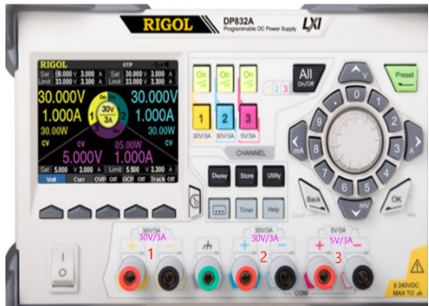
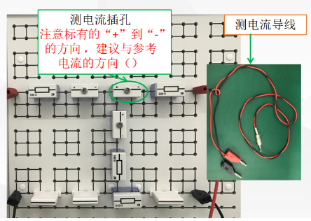
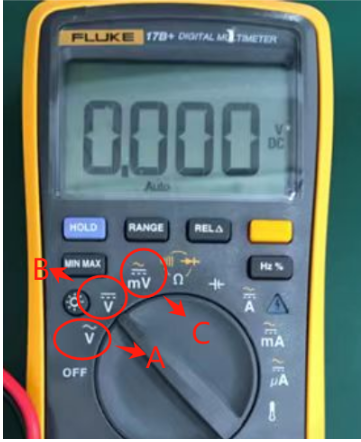
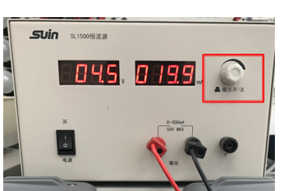
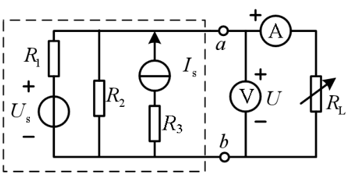

# 实验一 直流电路实验：预习题

本文件顺序仅用于阅读，不是答题定位键。选项和题序每次开始可能变化。

## 阅读序号1

若使用该直流稳压源输出10V的电压，可以使用该设备的哪个通道输出。

- 2

- 1

- 4

- 3

## 阅读序号2

测电流导线的一头插入测电流插孔中，另一头的红色端子需要接在电流表的正极性端，黑色端子接在电流表的负极性端，这样便将电流表串联到测电流插孔所在的支路。故，建议在摆放时应使得测电流插孔从“+”到“-”的方向与电路参考电流方向（），否则所测电流方向为（）。

- 一致，负

- 一致，相等

- 相反，相等

- 相反，负

## 阅读序号3

实验中，若测试电流，需要将电流表（）在电路中;若测试电压，需要将电压表（）在电路中

- 并联、并联

- 并联、串联

- 串联、并联

- 串联、串联

## 阅读序号4

可调电位器在接入实验二的电路前，一定要先用万用表测试其阻值，保证以阻值调到合适值或调到最（）值接入电路，防止因为阻值过（），电流过（），烧坏电位器

- 大，大，大

- 大，小，大

- 小，大，大

- 小，小，大

## 阅读序号5

若使用万用表的电压档测量5V的直流电压，应将旋钮调到图中哪个档位

- 皆可

- A

- C

- B

## 阅读序号6

使用万用表测量电压Uab，红色表笔与（）端连接，黑色表笔（）端连接

- b，a

- b，b

- a，a

- a，b

## 阅读序号7

实验时，要认真检查电路，防止电压源处于（）状态，电流源处于（）

- 开路、短路

- 开路、开路

- 短路，短路

- 短路、开路

## 阅读序号8

电流源使用时，旋转按钮表示（）按下按钮表示（）

- 不确定

- 电压调节、输出

- 输出、电流调节

- 电流调节，输出

## 阅读序号9

实验时，电压源单独作用时，需要电流源处开路，如何做使电流源处开路呢

- 仅仅拔掉电流源所在电路中的导线即可

- 关闭电流源，将电流源所在的支路用导线连接

- 仅仅关闭电流源即可

- 关闭电流源，拔掉电流源所在电路中的导线

## 阅读序号10

下图中（）表示有源一端口的输出

- b

- a,b点

- a

- 不确定

