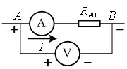
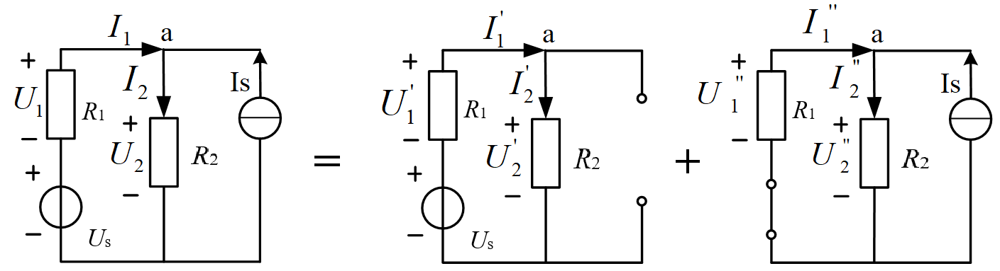
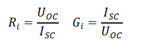

# 实验一 直流电路实验

对应指导书：[instruction_book.pdf](instruction_book.pdf)。本文件只含题目与课程说明，不含答案。

## 实验目的

1. 掌握常用仪器仪表在实际工程中的使用方法，了解仪器仪表的应用特性；
2. 理解电压、电流参考方向在电路中的作用，加深对基尔霍夫电压定律的理解；
3. 学习叠加定理的验证方法，加深对叠加定理的理解；
4. 通过实验验证并加深对基尔霍夫定律和叠加定理的理解；
5. 学习测量线性有源一端口网络的戴维南等效电路参数及端口外特性的方法，加深对戴维南定理的理解。

## 实验预习要求

1. 复习基尔霍夫定律、叠加定理、戴维南定理和诺顿定理的理论知识，完成实验预习考核中的内容；
2. 预习实验中所用的实验仪器的使用方法及注意事项；

## 实验仪器与器件

名称数量型号
1直流稳压电源1台DP832A
2手持万用表1台Fluke17B+
3直流电压电流表1块30111047
4电阻若干
5可变电阻1只
6测电流插孔3只
7电流插孔导线3条
8短接桥和连接导线若干P8-1和50148
9实验用9孔插件方板1块300mm×298mm
10直流恒流源1台SL1500

## 实验原理

实验原理
基尔霍夫定律
a.基尔霍夫电流定律（KCL）
在集中参数电路中，任一时刻流出（或流入）任一节点的支路电流代数和等于零，即：
 Σik=0（ik表示第k条支路电流）                    式（2-1）
此时，若取流出节点的电流为正，则流入节点的电流为负。它反映了电流的连续性，说明了节点上各支路电流的约束关系，它与电路中元件的性质无关。
要验证基尔霍夫电流定律，可选一电路节点，按图中的参考方向测定出各支路电流值，并约定流入或流出该节点的电流为正，将测得的各电流代入式（2-1），加以验证。
b.基尔霍夫电压定律（KVL）
在集中参数电路中，任一时刻，沿任一回路各支路电压的代数和等于零，即：
ΣUk=0           （Uk表示第k条支路电压）            式（2-2）
它说明了电路中各段电压的约束关系，它与电路中元件的性质无关。式（2-2）中，通常规定支路或元件电压的参考方向与回路绕行方向一致者取正号，反之取负号。
关于电压、电流的实际方向与参考方向的对应关系，参考方向是为了分析、计算电路而人为设定的。实验中测量的电压、电流的实际方向，由电压表、电流表的“正”端所标明。在测量电压、电流时，若电压表、电流表的“正”端与参考方向的“正”方向一致，则该测量值为正值，否则为负值。

图2- 1 电压，电流的实际方向和参考方向
关于电位与电位差，在电路中，电位的参考点选择不同，各节点的电位也相应改变，但任意两节点间的电位差不变，即任意两点间电压与参考点电位的选择无关。
2.4.2叠加定理
叠加定理：在线性唯一解的电路中，由几个独立电源共同作用产生的响应等于各个独立电源单独作用时产生相应响应的代数叠加。

(a)电压源电流源共同作用电路     (b)电压源单独作用电路    (c)电流源单独作用电路
图2- 2 叠加定理原理图
图2- 2所示实验电路中有一个电压源Us及一个电流源Is。设Us和Is共同作用时，在电阻R1上产生的电压、电流分别为U1、I1，在电阻R2上产生的电压、电流分别为U2、I2，如图2- 2 (a)所示。为了验证叠加原理令电压源和电流源分别作用。当电压源单独作用电路，电流源Is不作用即Is=0时，在Is处用开路代替（注意：需要把电流源的线从九孔方板中拔掉，不仅仅是关闭电流源）；当电流源单独作用电路，电压源Us不作用即Us=0时，在Us处用短路线代替。
（1） 设电压源Us单独作用时（电流源支路开路）引起的电压、电流分别为U1'、U2'、I1'、I2'，如图2- 2 (b)所示。
（2） 设电流源单独作用时（电压源支路短路）引起的电压、电流分别为U1''、U2''、I1''、I2''，如图2- 2  (c)所示。
这些电压、电流的参考方向均已在图中标明。验证叠加定理，即验证式（2-3）成立。
                                 式（2-3）
2.4.3戴维南定理和诺顿定理
戴维南定理：线性含源一端口网络的对外作用可以用一个电压源串联电阻的电路来等效代替。其中电压源的源电压等于此一端口网络的开路电压，而电阻等于此一端口网络内部各独立电源置零（电压源处短路，电流源处开路）后所得无独立源一端口网络的等效电阻。图2- 3所示。

图2- 3 戴维南定理图示
诺顿定理：线性含源一端口网络的对外作用可以用一个电流源并联电导的电阻来等效代替，其中电流源的源电流等于此一端口网络的短路电流，而电导等于此一端口网络内部各独立源置零（电压源处短路，电流源处开路）后所得无独立源一端口网络的等效电导。如图2- 4所示。

图2- 4 诺顿定理图示
一般情况下，含源一端口网络既可以用戴维南电路等效代替，也可以用诺顿电路等效代替。特殊情况下，若Ri=0，则只能等效为戴维南电路，并成为电压源，若Gi=0，则只能等效为诺顿电路，成为电流源。求等效电路相当于确定端口电压与电流的直线方程。根据直线方程的形式，设计出确定等效电路的实验方法。实际应用时，加以选择。下面介绍几种测量等效电路参数的实验方法。
（1） 测量开路电压和短路电流
如果一端口网络允许开路和短路，可分别测量开路电压Uoc和短路电流ISC，如图2- 5所示，得到直线在电压坐标轴和电流坐标轴上的截距，分别对应等效电路中的电压源的电压和电流源的电流，而等效电阻和等效电导分别为：
 
（2）测量开路电压和等效电阻
当一端口网络不允许短路时，可按图2- 5 (a)测量端口的开路电压Uoc；然后将一端口网络内独立电源置零（电压源处短路，电流源处开路），用万用表测出一端口网络的等效电阻Ri（参见图2- 6(a)，或在端口处外加电源，通过测量端口电压U与电流I，计算U/I=Ri，参见图2- 6 (b)。

a）测开路电压                b）测短路电流
图2- 5方法一的原理示意图

a）用欧姆表测电阻                b）用外加电源测电阻
图2- 6 方法二测量等效电阻的原理示意图
（3）测量短路电流和等效电阻
当一端口网络不允许开路时，将方法二中测量端口的开路电压更改为测量端口的短路电流ISC即可。

[图片不可用：源网页误引用作者电脑本地临时文件，无法下载]

[图片不可用：源网页误引用作者电脑本地临时文件，无法下载]

## 实验报告

### 第1题（5分）

请附上实验课实操的实验数据记录（截图或拍照，以图片形式上传即可）

### 第2题（5分）

根据实验内容和实验数据，简述KVL的验证过程（不能抄袭指导书），分析实验结果是否满足KVL

### 第3题（5分）

根据实验内容和实验数据，简述叠加的验证过程（不能抄袭指导书），分析实验结果是否满足叠加定理

### 第4题（20分）

根据实验内容和实验数据，简述线性含源一端口电阻网络等效电路参数测试的验证过程（不能抄袭指导书），分析实验结果

### 第5题（25分）

上传外特性曲线，对比三组曲线是否存在差别及原因。

### 第6题（15分）

在叠加原理验证实验中，通过对实验数据的计算，判别电阻上的功率是否也符合叠加原理？

### 第7题（25分）

简述电压源为什么不能短路，电流源为什么不能开路？本次实验的体会与建议。
