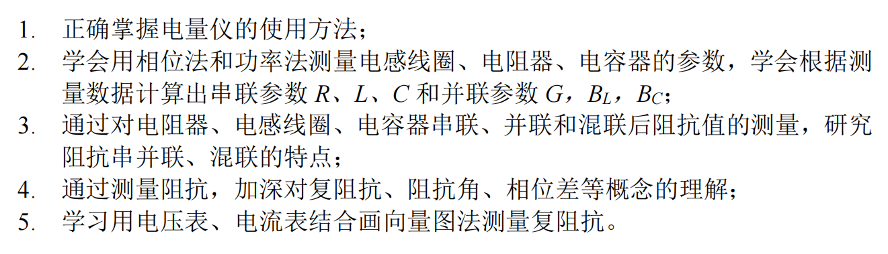
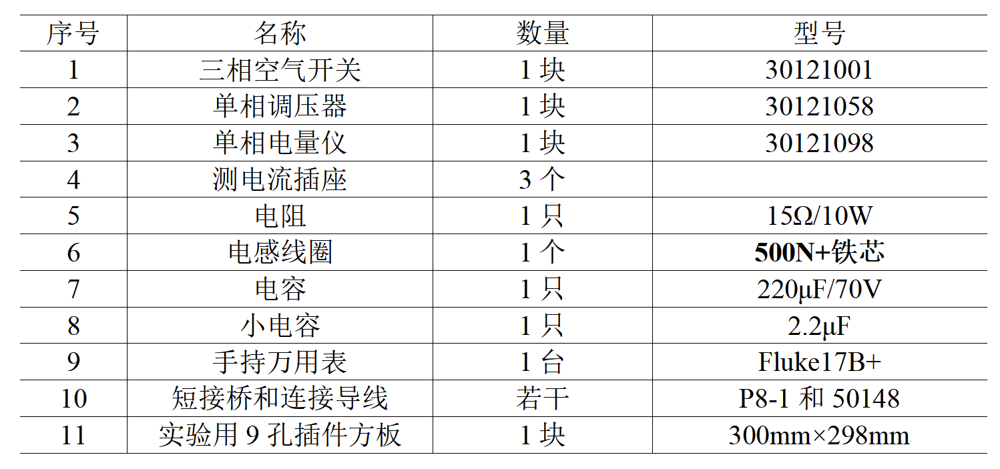
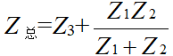

# 实验二 元器件参数测量和阻抗的串并联

对应指导书：[instruction_book.pdf](instruction_book.pdf)。本文件只含题目与课程说明，不含答案。

## 实验目的

## 实验仪器与器件

## 实验报告要求

1.数据处理过程要写在实验数据记录表上，原始测量数据在课堂上需要老师确认。
2.由数据得出的曲线在实验后完成，并画在坐标纸（或网格纸）上。
3.实验结果分析及实验结论要根据实验结果给出。
4.实验的感想、意见和建议写在实验结论之后。
5.实验报告中所有需要上传的皆以图片形式，勿以附件上传。

## 实验数据分析

### 第1题（5分）

简述实验原理。

### 第2题（5分）

完善实验数据记录页的理论值计算部分，之后以图片的形式上传，注意带有老师签字或盖章。

### 第3题（15分）

测量电阻器与电感线圈串联的阻抗$Z_{总}$，画出设计电路图。根据测试数据，求出$Z_{总}$，利用表2-5数据计算出$Z_{1}$、$Z_{2}$，验证串联$Z_{总}=Z_{1}+Z_{2}$。

### 第4题（15分）

测量电阻器与电感线圈并联的总导纳$Y_{总}$，设计电路图如下。求出$Y_{总}$，利用表2-6数据计算出$Y_{1}$、$Y_{2}$，验证并联时 $Y_{总}=Y_{1}+Y_{2}$ 。

### 第5题（15分）

测量电阻器与电感线圈并联，再与电容器串联后的总阻抗$Z_{总}$，设计电路图如下。根据表2-7数据求出$Z_{总}$，计算出$Z_{1}$、$Z_{2}$、$Z_{3}$，验证。

### 第6题（20分）

伏特-安培法测试元件参数，根据表2-8的数据，先用余弦定理求出电压与电流的相位角，后画出各电压相量图，求出复阻抗$Z_{1}$（电阻器）、$Z_{2}$（电感线圈）及 $Z_{总}$，求出电感线圈的电阻$r$和电感量$L$。

## 实验思考

### 第1题（10分）

相位法和功率法测得的电阻值，电感值，电容值是否一致？如果存在少许差异，请进行可能的原因分析。

### 第2题（10分）

比较相位法与电压表、电流表向量图法测出的阻抗与导纳是否一致。如果存在少许差异，请进行可能的原因分析。

### 第3题（5分）

简述实验总结、体会与建议。
