# 实验四 RLC元件的阻抗特性、谐振电路及RC选频网络特性：预习答案

按题干和答案内容匹配，不使用题号或选项字母。

## 一端口电路发生谐振是指什么？（）

答案：对于任何含有电感线圈和电容元件的一端口电路，在一定条件下，电路负载可呈现纯电阻性，端口电压与电流同相位，则称一端口电路发 生谐振。

来源：站点现有试卷返回的答案字段，按同一次响应的选项内容解析。

验证：site_key_not_independently_score_verified

## $R−L−C$串联谐振电路发生谐振时，品质因数$Q$可表示为（）

答案：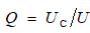

答案：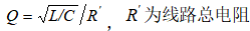

答案：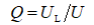

来源：站点现有试卷返回的答案字段，按同一次响应的选项内容解析。

验证：site_key_not_independently_score_verified

## $R-L-C$串联谐振电路，从通用串联谐振曲线中可知，通频带$Δf$定义为（）。

答案：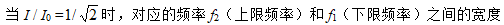

来源：站点现有试卷返回的答案字段，按同一次响应的选项内容解析。

验证：site_key_not_independently_score_verified

## $R-L-C$串联谐振电路发生谐振时，下面哪些现象或关系是正确的？（）

答案：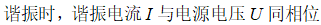

答案：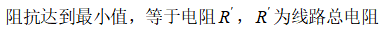

答案：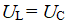

答案：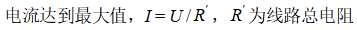

来源：站点现有试卷返回的答案字段，按同一次响应的选项内容解析。

验证：site_key_not_independently_score_verified

## 正弦交流电路中，电容器的容抗为（）

答案：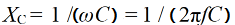

来源：站点现有试卷返回的答案字段，按同一次响应的选项内容解析。

验证：site_key_not_independently_score_verified

## $R-L-C$串联谐振电路发生谐振时，谐振角频率为（）

答案：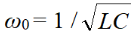

来源：站点现有试卷返回的答案字段，按同一次响应的选项内容解析。

验证：site_key_not_independently_score_verified

## 下面哪一个通用串联谐振曲线的信息是正确的？（）

答案：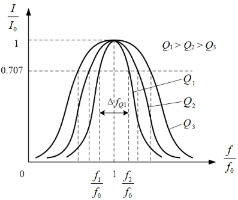

来源：站点现有试卷返回的答案字段，按同一次响应的选项内容解析。

验证：site_key_not_independently_score_verified

## 正弦交流电路中，电感的感抗为（）

答案：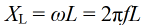

来源：站点现有试卷返回的答案字段，按同一次响应的选项内容解析。

验证：site_key_not_independently_score_verified

## $R-L-C$串联谐振电路中，品质因数$Q$和通频带$Δf$有什么样的关系?

答案：$Q值越大，通频带越窄，电路的选择性越好。$

来源：站点现有试卷返回的答案字段，按同一次响应的选项内容解析。

验证：site_key_not_independently_score_verified

## $R-L-C$串联谐振电路发生谐振时，谐振频率为（）

答案：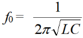

来源：站点现有试卷返回的答案字段，按同一次响应的选项内容解析。

验证：site_key_not_independently_score_verified

