# 实验四 RLC元件的阻抗特性、谐振电路及RC选频网络特性：预习题

本文件顺序仅用于阅读，不是答题定位键。选项和题序每次开始可能变化。

## 阅读序号1

一端口电路发生谐振是指什么？（）

- 对于任何含有电感线圈和电容元件的一端口电路，在一定条件下，电容元件和电阻元件两端电压相等，相位相同，则称一端口电路发生谐 振。

- 对于任何含有电感线圈和电容元件的一端口电路，在一定条件下，电感线圈和电阻元件两端电压相等，相位相同，则称一端口电路发生谐 振。

- 对于任何含有电感线圈和电容元件的一端口电路，在一定条件下，电感线圈和电容元件两端电压相等，相位相同，则称一端口电路发生谐 振。

- 对于任何含有电感线圈和电容元件的一端口电路，在一定条件下，电路负载可呈现纯电阻性，端口电压与电流同相位，则称一端口电路发 生谐振。

## 阅读序号2

$R−L−C$串联谐振电路发生谐振时，品质因数$Q$可表示为（）

- 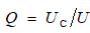

- 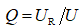

- 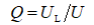

- 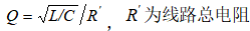

## 阅读序号3

$R-L-C$串联谐振电路，从通用串联谐振曲线中可知，通频带$Δf$定义为（）。

- 通过的高频率范围。

- 

- 通过的低频率范围。

- 通过的中间频率范围。

## 阅读序号4

$R-L-C$串联谐振电路发生谐振时，下面哪些现象或关系是正确的？（）

- 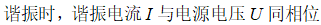

- 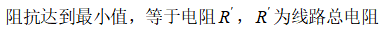

- 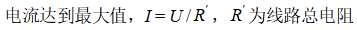

- 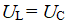

## 阅读序号5

正弦交流电路中，电容器的容抗为（）

- 

- 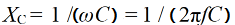

- 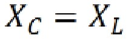

- 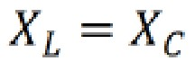

## 阅读序号6

$R-L-C$串联谐振电路发生谐振时，谐振角频率为（）

- 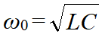

- 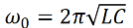

- 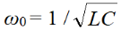

- 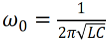

## 阅读序号7

下面哪一个通用串联谐振曲线的信息是正确的？（）

- 

- 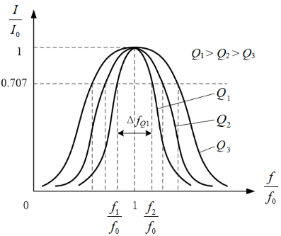

- 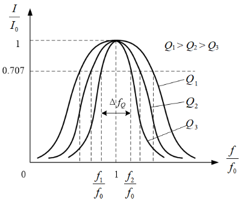

- 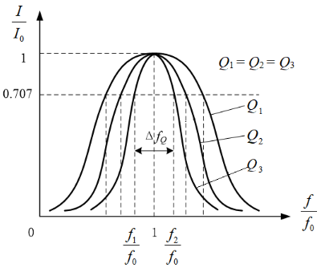

## 阅读序号8

正弦交流电路中，电感的感抗为（）

- 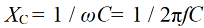

- 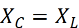

- 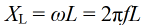

- 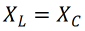

## 阅读序号9

$R-L-C$串联谐振电路中，品质因数$Q$和通频带$Δf$有什么样的关系?

- $Q值越大，通频带越窄，电路的选择性越好。$

- $Q值越小，通频带越窄，电路的选择性越好。$

- $Q值越大，通频带越宽，电路的选择性越好。$

- $Q值越小，通频带越宽，电路的选择性越好。$

## 阅读序号10

$R-L-C$串联谐振电路发生谐振时，谐振频率为（）

- 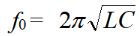

- 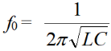

- 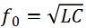

- 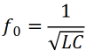

