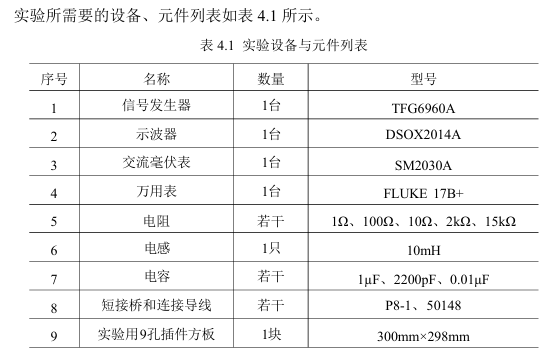
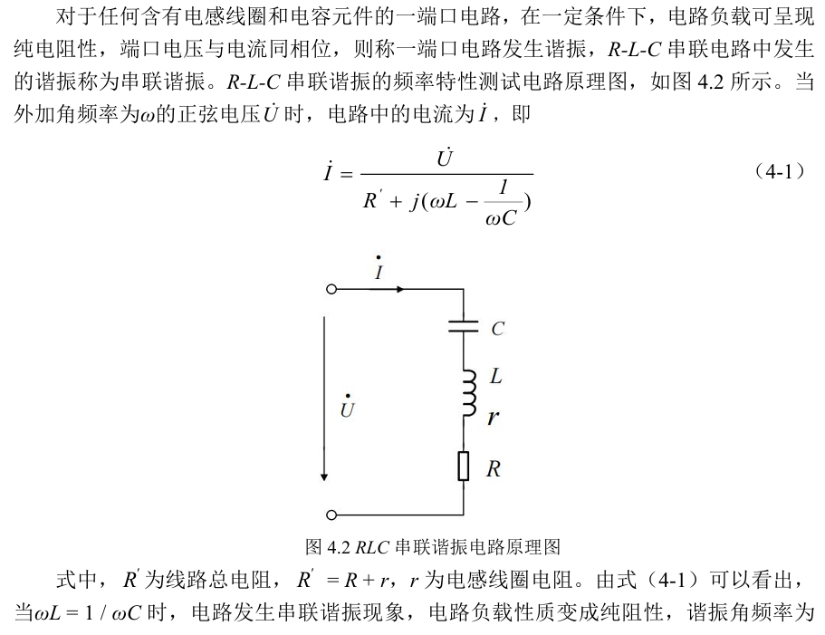
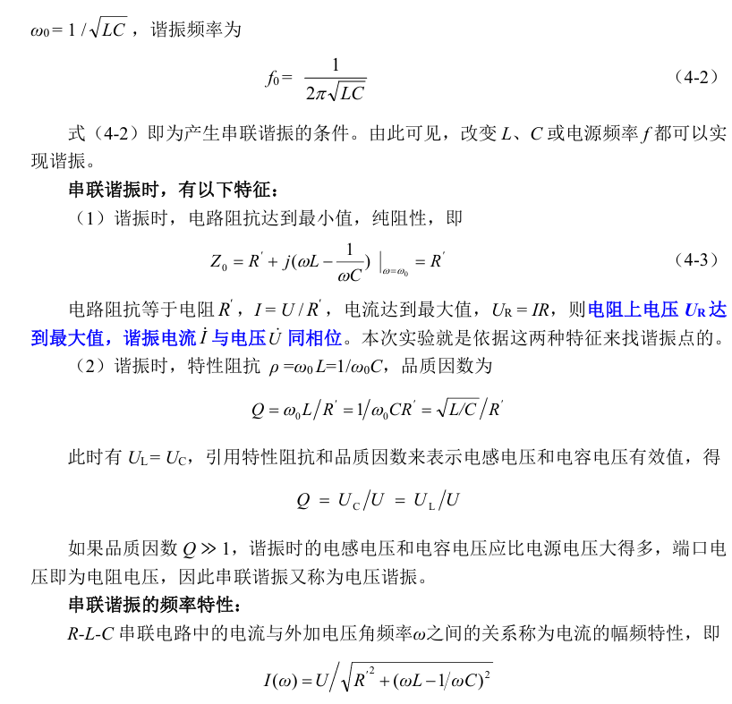
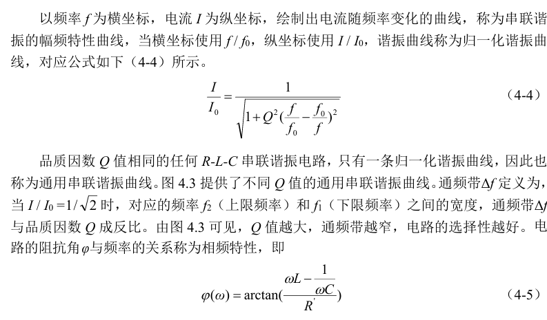
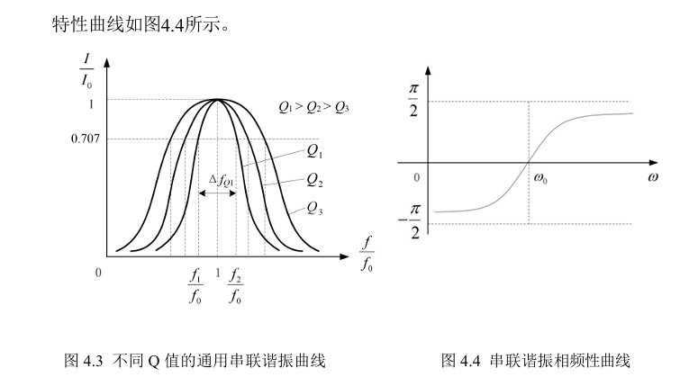

# 实验四 RLC元件的阻抗特性、谐振电路及RC选频网络特性

对应指导书：[instruction_book.pdf](instruction_book.pdf)。本文件只含题目与课程说明，不含答案。

## 实验目的

1.通过实验进一步通过实验进一步理解R，L，C的阻抗特性，理解R-L-C串联电路的频率特性，了解串联谐振现象；
2. 研究电路参数对串联谐振电路的影响，学习函数发生器和双通道示波器的用法；
3. 理解串联谐振电路的选频特性及应用，以及RC选频网络的选频实际意义；
4. 掌握测试通用谐振曲线和品质因数的测量、计算方法。

## 实验设备与元器件

## 实验原理

## 实验步骤内容与数据分析

### 第1题（10分）

请上传实验过程原始数据记录页（应有教师签章）(上传图片，或直接手机拍照，请不要传附件)

### 第2题（0分）

4.5.2 串联谐振电路
1. 寻找谐振频率，验证谐振电路特点
2. 测定电路参数，绘制串联谐振曲
3. 用示波器查看R-L-C串联谐振电路的电压电流波形相位关系

### 第3题（5分）

在寻找谐振频率，验证谐振电路特点实验步骤中，采用的是什么方式来实现串联谐振？电路中R、L、C参数是如何选取的？理论计算的谐振频率约等于多少？信号发生器输出电压在整个实验过程中如何调节？（请文字作答，禁止直接贴图片，禁止直接拍照，禁止传附件，不按要求作答此项不得分）

### 第4题（5分）

在寻找谐振频率，验证谐振电路特点实验步骤中，用什么仪器测试电压有效值UR、UL、UC？使用示波器观测电阻两端电压波形和输入信号源电压波
形时，如何判断电路产生了谐振现象？（请文字作答，禁止直接贴图片，禁止直接拍照，禁止传附件，不按要求作答此项不得分）

### 第5题（5分）

请整理原始数据，并完成表4.2 数据计算或记录，请提供表4.2完整数据。（可绘制表格截图上传，表格请规范绘制，请不要传附件）

### 第6题（10分）

在测定电路参数，绘制串联谐振曲线实验步骤中，请整理原始数据，根据表4.3（a）、表4.3（b）和表4.3（c）中数据，计算数据I、I/I0及f/f0并将表格填写完整，请提供表4.3完整数据。（可绘制表格截图上传，表格请规范绘制，请不要传附件）。

### 第7题（10分）

在测定电路参数，绘制串联谐振曲线实验步骤中，请根据表4.3（a）、表4.3（b）和表4.3（c）中记录和计算的数据，使用描点法，绘制通用串联谐振曲线，手绘或绘图工具绘图不限，但需符合描点法的基本要求。要求，三个不同Q值的通用串联谐振曲线要绘制在同一个坐标系下，并且要标出横纵坐标和Q值与曲线的对应关系。（可截图上传，截图需清晰，请不要传附件）

### 第8题（10分）

在测定电路参数，绘制串联谐振曲线实验步骤中，已绘制的谐振曲线（同一坐标系下），有各自的Q值。请分析通频带与品质因数的关系，并说明电路的选择性与二者之间的关系。（请文字作答，禁止直接贴图片，禁止直接拍照，禁止传附件，不按要求作答此项不得分）

### 第9题（10分）

在用示波器查看R-L-C串联谐振电路的波形相位关系实验步骤中，如何使用示波器观察输入电压和电路电流的相位关系？（回答中要说明电路电流的波形为何可用电阻上的电压代替，要说明如何接探头，如何使用示波器测量功能）（请文字作答，禁止直接贴图片，禁止直接拍照，禁止传附件，不按要求作答此项不得分）

### 第10题（10分）

在用示波器查看R-L-C串联谐振电路的波形相位关系实验步骤中，调节信号发生器的输出频率（保持1Vrms有效值不变），在f0两侧缓慢变化，观察示波器屏幕上输入电压和电路电流波形的相位和幅度的变化。请分别记录绘制输入电压频率等于谐振频率f0，低于谐振频率f0，和高于谐振频率f0时的电压与电流波形相位关系，完成指导书中图4.10，注意标出电压和电流的波形曲线，同时标出电压电流曲线的频率和幅值。（可截图上传，需注明图片内容，请不要传附件）

### 第11题（10分）

在用示波器查看R-L-C串联谐振电路的波形相位关系实验步骤中，调节信号发生器的输出频率（保持1Vrms有效值不变），在f0两侧缓慢变化，观察示波器屏幕上输入电压和电路电流波形的相位和幅度的变化，请分析变化原因。当输入电压频率高于谐振频率f0时，电路负载是什么性质？当输入电压频率低于谐振频率f0时，电路负载是什么性质？（请文字作答，禁止直接贴图片，禁止直接拍照，禁止传附件，不按要求作答此项不得分）

## 实验思考

### 第1题（10分）

请根据实验结果，完成总结思考题：判断电路发生串联谐振的主要方法有哪些？（请文字作答，禁止直接贴图片，禁止直接拍照，禁止传附件，不按要求作答此项不得分）

### 第2题（5分）

请根据实验结果，完成总结思考题：简述品质因数Q对串联谐振电路性能的影响？（请文字作答，禁止直接贴图片，禁止直接拍照，禁止传附件，不按要求作答此项不得分）
