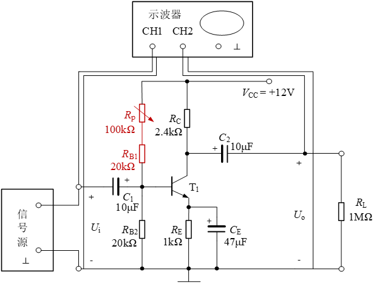

# 实验五 单管交流放大电路

对应指导书：[instruction_book.pdf](instruction_book.pdf)。本文件只含题目与课程说明，不含答案。

## 实验报告

### 第1题（5分）

请简述单管交流放大电路实验的实验目的。

### 第2题（5分）

请列写单管交流放大电路实验的实验设备及元器件。

### 第3题（5分）

请简述单管交流放大电路实验的实验原理。

### 第4题（10分）

请上传单管交流放大电路实验的原始数据记录页。

### 第5题（10分）

根据表5-3中ui和uo的数据，推导说明Ce变化对输出波形影响的原因。

### 第6题（15分）

根据表5-4，并推导分析负载变化对交流电压放大倍数的影响原因。

### 第7题（20分）

自建坐标系，表明刻度及尺寸，绘制表5-5中的ui和uo波形，并注明失真判断。

### 第8题（10分）

输入信号合适的情况下，共射基本放大电路出现饱和失真或截止失真的原因是什么？电路中应调整哪个元件？

### 第9题（10分）

由于Vcc、Rp、RB1、RB2和地构成的回路一直处于耗能状态，请查阅资料，在实际的单管放大电路中，如何解决此问题？（可绘图说明）

### 第10题（5分）

在此次使用的放大电路中，如何提高电压放大倍数？

### 第11题（5分）

总结失真类型的判断方法，说明本实验中的放大电路的输出出现削顶失真时，为截止失真，还是饱和失真？这一结论适用于由PNP型管构成的共射级放大电路吗？请说明理由。

### 第12题（0分）

本次实验体会与建议。（本题不占分，可填“无”）。
