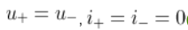

# 实验六 集成运算放大器的应用实验：预习答案

按题干和答案内容匹配，不使用题号或选项字母。

## 理想运算放大器的开环放大倍数$A_{uo}$为？

答案：无穷大

来源：站点现有试卷返回的答案字段，按同一次响应的选项内容解析。

验证：independently_solved_and_quiz_score_100

推导：理想运放的开环增益趋于无穷大。

## 理想运算放大器的输入电阻为？输出电阻为？

答案：无穷大，0

来源：站点现有试卷返回的答案字段，按同一次响应的选项内容解析。

验证：independently_solved_and_quiz_score_100

推导：理想输入电阻无穷大、输出电阻为零。

## 集成运算放大器能处理什么类型的信号？

答案：交流信号和直流信号

来源：站点现有试卷返回的答案字段，按同一次响应的选项内容解析。

验证：independently_solved_and_quiz_score_100

推导：运放为直接耦合，可处理直流与交流。

## 集成运放工作在线性放大区，由理想工作条件得出两个重要规律是？

答案：

来源：站点现有试卷返回的答案字段，按同一次响应的选项内容解析。

验证：independently_solved_and_quiz_score_100

推导：线性负反馈下两输入端等电位且输入电流为零，并非两端电压都为零。

## 若要将幅度为$ \pm U_m$的矩形波转变为三角波，则应选用？

答案：积分运算电路

来源：站点现有试卷返回的答案字段，按同一次响应的选项内容解析。

验证：independently_solved_and_quiz_score_100

推导：恒定电压积分得到线性斜坡，矩形波积分为三角波。

## 函数信号发生器需要交流量叠加直流输出时，需调节？

答案：偏移

来源：站点现有试卷返回的答案字段，按同一次响应的选项内容解析。

验证：independently_solved_and_quiz_score_100

推导：信号发生器的直流偏移设置叠加直流分量。

## 分析集成运放的非线性应用电路时，不能使用的特性是？

答案：虚短

来源：站点现有试卷返回的答案字段，按同一次响应的选项内容解析。

验证：independently_solved_and_quiz_score_100

推导：非线性应用不保证两输入端电位相等。

## 单限电压比较器有（ ）个门限电压，滞回电压比较器有（ ）个门限电压。

答案：1，2

来源：站点现有试卷返回的答案字段，按同一次响应的选项内容解析。

验证：independently_solved_and_quiz_score_100

推导：单限比较器一个阈值，滞回比较器两个阈值。

## 当集成运放芯片的电源为正负对称电源供电时，不可把正、负电源极性接反或将输出端短路，否则会烧坏芯片。

答案：正确

来源：站点现有试卷返回的答案字段，按同一次响应的选项内容解析。

验证：independently_solved_and_quiz_score_100

推导：电源极性接反和输出短路可能损坏运放，须避免。

## 在由运放组成的电路中，运放工作在非线性状态的电路是？

答案：电压比较器

来源：站点现有试卷返回的答案字段，按同一次响应的选项内容解析。

验证：independently_solved_and_quiz_score_100

推导：比较器使用运放的饱和非线性状态。

