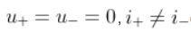
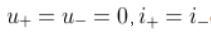
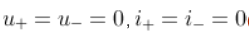
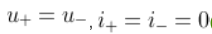

# 实验六 集成运算放大器的应用实验：预习题

本文件顺序仅用于阅读，不是答题定位键。选项和题序每次开始可能变化。

## 阅读序号1

理想运算放大器的开环放大倍数$A_{uo}$为？

- 无穷大

- 1

- 0

- 不定

## 阅读序号2

理想运算放大器的输入电阻为？输出电阻为？

- 0，0

- 无穷大，无穷大

- 0，无穷大

- 无穷大，0

## 阅读序号3

集成运算放大器能处理什么类型的信号？

- 仅交流信号

- 以上都不对

- 仅直流信号

- 交流信号和直流信号

## 阅读序号4

集成运放工作在线性放大区，由理想工作条件得出两个重要规律是？

- 

- 

- 

- 

## 阅读序号5

若要将幅度为$ \pm U_m$的矩形波转变为三角波，则应选用？

- 反向比例运算电路

- 积分运算电路

- 同相比例运算电路

- 微分运算电路

## 阅读序号6

函数信号发生器需要交流量叠加直流输出时，需调节？

- 周期

- 同相位

- 偏移

- 幅值

## 阅读序号7

分析集成运放的非线性应用电路时，不能使用的特性是？

- 都不对

- 虚短

- 差模输入电阻无穷大

- 虚断

## 阅读序号8

单限电压比较器有（ ）个门限电压，滞回电压比较器有（ ）个门限电压。

- 2，2

- 1，2

- 2，1

- 1，1

## 阅读序号9

当集成运放芯片的电源为正负对称电源供电时，不可把正、负电源极性接反或将输出端短路，否则会烧坏芯片。

## 阅读序号10

在由运放组成的电路中，运放工作在非线性状态的电路是？

- 差值放大器

- 电压比较器

- 有源滤波器

- 反相放大器

