# 实验六 集成运算放大器的应用实验

对应指导书：[instruction_book.pdf](instruction_book.pdf)。本文件只含题目与课程说明，不含答案。

## 实验目的

1.        掌握集成运算放大器的基本运算功能及其正确使用；
2.        掌握集成运算放大器常用单元电路的设计和调试方法；
3.        熟悉示波器、低频信号发生器、毫伏表的使用方法。

## 实验预习要求

1.复习集成运算放大器的基本理论知识，观看实验仪器的使用视频，及示例接线的实验视频；
2.预习实验注意事项，完成所有理论值的计算，完成Easy云课堂上的实验预习测验；
3.掌握正负15V电源的连接方法。

## 实验设备与元器件

名称型号数量
直流稳压电源DP832A1台
信号发生器DG40621台
示波器TEK MSO 2012B1台
集成运算放大器LM741或μA7411块
电阻100Ω、10kΩ、20kΩ、100kΩ若干
电容0.1μF、0.01μF各1只
短接桥和连接导线P8-1和50148若干
实验用九孔插件方板300mm×298mm1块

## 实验原理

集成运算放大器是最重要的模拟集成电路之一。它具有体积小、功耗低、可靠性高等优点，种类繁多，应用广泛。从工作原理上，集成运算放大器可分为线性应用和非线性应用两方面。在线性工作区内，其输出电压uo与输入电压ui的线性放大的关系为

在工程应用情况下，将集成运放视为理想运放，就是将集成运放的各项技术指标理想化，满足下列条件的运算放大器称为理想运放，即
(1) 开环电压放大倍数
(2) 输入阻抗
(3) 输出阻抗
(4) 带宽
(5) 失调与漂移均为零
理想运放工作在线性区的分析依据是，输入端的虚短（）、虚断（）和虚地（同相端接地时，）。
理想运放工作在非线性区的分析依据是，，，，。
本实验中使用的集成运算放大器为通用集成运放LM741或者μA741，其引脚及引脚功能如图5-1所示。2脚为运放的反相输入端，3脚为运放的同相输入端，6脚为运放的输出端，7脚为正电源引脚，4脚为负电源引脚。1脚和5脚为输出调零端，8脚为空脚。

(a) LM741的引脚排列图
(b) LM741实物图（使用时先找半圆形缺口朝向）
5.4.1     加法运算电路
根据信号输入端的不同有同相加法电路和反相加法电路两种形式。其运算电路如图5-2和图5-3所示。

图5-2 同相加法运算电路

图5-3 反相加法运算电路
同相加法运算电路的输出电压为

其中，
因此，Rp与每个回路电阻均有关，要满足一定的比例关系，调节不便。
反相加法运算电路的输出电压为

当时，
5.4.2     减法运算电路

图5-4 减法运算电路
减法运算电路实际上是反相比例运算电路和同相比例运算电路的组合，其运算电路如图5-4所示。在理想条件下，输出电压与各输入电压的关系为：

当和时，则上式为：

5.4.3     积分运算电路

图5-5 积分运算电路
同相输入和反相输入可以构成积分运算电路，在此以反相积分为例，其运算电路如图5-5所示。在理想条件下，输出电压与输入电压的关系为

即输出电压的大小与输入电压对时间的积分值成正比关系，这个比值由电阻R1和电容C决定，时间常数R1C的数值愈大，达到给定的输出值所需要的时间就愈长，式中的负号表示输出与输入电压的反相关系。
1）当输入信号为一直流电压U时且电容初始值为0，积分电路的输出电压为。输出电路为斜坡电压，但其输出电压值不会无限制的增加，当输出达到饱和时就不再增加，显然，R1C的数值愈大，达到饱和所需的时间就愈长。
2）当输入信号为方波电压时，积分电路的输出电压为

输出为三角波，为了使三角波的幅度满足要求，要注意时间常数R1C的选择：R1C值过大，在一定的积分时间内，输出电压会过低，无法满足输出幅度的要求；R1C值过小，积分电路的输出会在未达到积分时间要求时就饱和了。
5.4.4     微分运算电路

图5-6 微分运算电路
微分运算是积分运算的逆运算，只需将反相输入端的电阻和反馈电容调换位置，就称为微分运算电路，其运算电路如图5-6所示。
在理想条件下，输出电压与输入电压的关系为

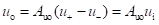

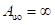

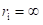

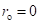

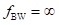

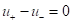

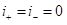

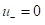

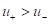

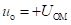

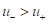

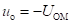

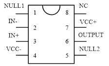

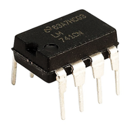

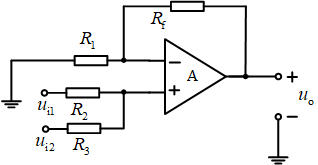

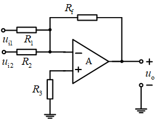

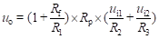

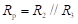

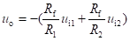

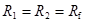

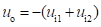

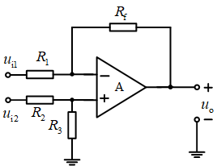

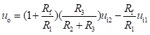

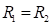

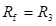

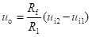

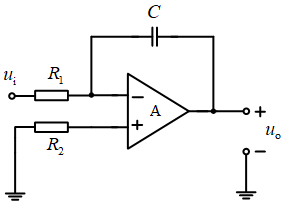

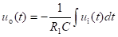

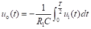

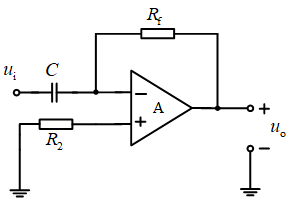

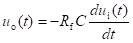

## 实验报告

### 第1题（5分）

简述实验六的实验目的。

### 第2题（5分）

请上传实验过程原始数据记录页（记录页上应写有个人姓名及学号、并附有教师盖章）。

### 第3题（10分）

画出减法器的实验电路图，并根据理论计算元器件参数（要有计算过程），最后绘制电压$u_{i2}$和$u_{o}$的波形（采用坐标纸或者网格纸，注意绘图规范，不要直接使用示波器照片，可以为手绘或电脑作图）

### 第4题（5分）

画出加法器的实验电路图，并根据理论计算选元器件参数（要有计算过程）

### 第5题（10分）

将积分电路、微分电路按照实验指导书的要求，绘制输入和输出电压波形，输入和输出需在同一坐标系下绘制（采用坐标纸，注意绘图规范，不要直接使用示波器照片，可以为手绘或电脑作图）

### 第6题（10分）

在减法器和加法器电路中，输入信号是否都需要同相位？为什么？在本次实验的加法器实验中，示波器观察加法器输出信号时，是否可以采用AC耦合方式？为什么？

### 第7题（10分）

实验电路电阻为什么使用kΩ级电阻而不使用Ω或MΩ级电阻？请分别分析电阻过小、过大带来的问题。（提示：电阻过小时从电流角度分析，电阻过大时从信号噪声角度分析）

### 第8题（10分）

实际的微分电路，往往在输入端与电容C之间串联入一个小电阻的同时在反馈通路电阻上并联一个小电容，请分析原因。（提示：电容电压是连续变化的，阻塞和自激振荡）

### 第9题（5分）

电阻、电容本身就可组成积分器，为什么还要用运算放大器？

### 第10题（10分）

反相比例放大器与同相比例放大器的输入、输出电阻各有什么特点？试用负反馈概念结合二者中任意一个的电路解释。

### 第11题（10分）

为了防止集成运放的正、负电源的极性接反而损坏集成运放，应在集成运放的电源端加什么保护电路？请画出保护电路图。

### 第12题（10分）

在实际测试中，如果发现运算放大器的输出电压与理论值相差很多，接近电源电压，是什么原因造成的？（至少回答4点，原因合理即可）
