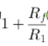
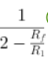
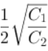
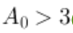

# 实验七 有源滤波电路研究：预习答案

按题干和答案内容匹配，不使用题号或选项字母。

## 有源滤波器的阶数越（ ），滤波器的滤波性能越 （ ）。

答案：高，好

来源：站点现有试卷返回的答案字段，按同一次响应的选项内容解析。

验证：independently_solved_and_quiz_score_100

推导：阶数增加使阻带衰减更陡，逼近理想特性。

## 根据实验指导书的实验原理部分，二阶有源低通滤波器和二阶压控电压源有源低通滤波器特性描述正确的有哪些？

答案：二阶压控电压源有源低通滤波器通带内的放大倍数为

答案：二阶有源低通滤波器通带内的放大倍数为1

答案：二阶压控电压源有源低通滤波器的品质因数为

答案：二阶有源低通滤波器的品质因数为

来源：站点现有试卷返回的答案字段，按同一次响应的选项内容解析。

验证：independently_solved_and_quiz_score_100

推导：指导书7.4给出这四个表达式，全部成立。

## 二阶压控电压源有源低通滤波器产生自激振荡的条件是什么？

答案：

来源：站点现有试卷返回的答案字段，按同一次响应的选项内容解析。

验证：independently_solved_and_quiz_score_100

推导：按指导书7.4，A0>3时极点进入右半平面，自激振荡。

## 有源滤波器与无源滤波器相比，在电路性能指标方面，其主要优势是什么？

答案：可以提供电压增益

来源：站点现有试卷返回的答案字段，按同一次响应的选项内容解析。

验证：independently_solved_and_quiz_score_100

推导：有源器件可在滤波同时提供增益。

## 有源滤波器的带宽指的是什么？

答案：滤波器允许通过的最高频率与最低频率之差

来源：站点现有试卷返回的答案字段，按同一次响应的选项内容解析。

验证：independently_solved_and_quiz_score_100

推导：带宽为通带上下边界频率之差。

## 有源带通滤波器的主要特点是什么？

答案：允许某一频段内的信号通过，其他频段信号被阻断

来源：站点现有试卷返回的答案字段，按同一次响应的选项内容解析。

验证：independently_solved_and_quiz_score_100

推导：带通通过中间频段并抑制两侧频段。

## 在设计有源滤波器时，下列哪个参数通常不被考虑？

答案：滤波器的绝缘电阻

来源：站点现有试卷返回的答案字段，按同一次响应的选项内容解析。

验证：independently_solved_and_quiz_score_100

推导：该题列出的常用设计指标为截止频率、增益和功耗。

## 在有源高通滤波器中，若要提高截止频率，以下哪种措施是有效的？

答案：减小电容值

来源：站点现有试卷返回的答案字段，按同一次响应的选项内容解析。

验证：independently_solved_and_quiz_score_100

推导：fc与RC乘积成反比，减小C提高截止频率。

## 以下哪种方法不是用于改善有源滤波器性能的有效手段？

答案：减小滤波器的电源电压

来源：站点现有试卷返回的答案字段，按同一次响应的选项内容解析。

验证：independently_solved_and_quiz_score_100

推导：减小电源电压不是普遍改善性能的方法，可能减小动态范围。

## 有源滤波器的主要分类有（ ）。

答案：低通滤波器

答案：高通滤波器

答案：带通滤波器

答案：带阻滤波器

来源：站点现有试卷返回的答案字段，按同一次响应的选项内容解析。

验证：independently_solved_and_quiz_score_100

推导：按通带位置分为低通、高通、带通、带阻四类。

