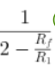
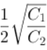
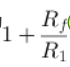
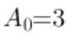
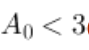
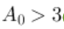

# 实验七 有源滤波电路研究：预习题

本文件顺序仅用于阅读，不是答题定位键。选项和题序每次开始可能变化。

## 阅读序号1

有源滤波器的阶数越（ ），滤波器的滤波性能越 （ ）。

- 低，好

- 高，好

- 低，不变

- 高，差

## 阅读序号2

根据实验指导书的实验原理部分，二阶有源低通滤波器和二阶压控电压源有源低通滤波器特性描述正确的有哪些？

- 二阶有源低通滤波器通带内的放大倍数为1

- 二阶压控电压源有源低通滤波器的品质因数为

- 二阶有源低通滤波器的品质因数为

- 二阶压控电压源有源低通滤波器通带内的放大倍数为

## 阅读序号3

二阶压控电压源有源低通滤波器产生自激振荡的条件是什么？

- 

- 

- 都不是

- 

## 阅读序号4

有源滤波器与无源滤波器相比，在电路性能指标方面，其主要优势是什么？

- 可以提供电压增益

- 体积更小

- 滤波性能更好

- 成本更低

## 阅读序号5

有源滤波器的带宽指的是什么？

- 滤波器的增益大小

- 滤波器允许通过的最高频率与最低频率之差

- 滤波器的输入电阻大小

- 滤波器的输出电压大小

## 阅读序号6

有源带通滤波器的主要特点是什么？

- 允许所有频段信号通过

- 允许某一频段内的信号通过，其他频段信号被阻断

- 允许高频信号通过，阻断低频信号

- 允许低频信号通过，阻断高频信号

## 阅读序号7

在设计有源滤波器时，下列哪个参数通常不被考虑？

- 滤波器的绝缘电阻

- 截止频率

- 滤波器的功耗

- 通带增益

## 阅读序号8

在有源高通滤波器中，若要提高截止频率，以下哪种措施是有效的？

- 减小电容值

- 增大电容值

- 使用更高增益的运放

- 增大电阻值

## 阅读序号9

以下哪种方法不是用于改善有源滤波器性能的有效手段？

- 减小滤波器的电源电压

- 优化电阻和电容的值

- 使用更高增益的运算放大器

- 增加滤波器的阶数

## 阅读序号10

有源滤波器的主要分类有（ ）。

- 低通滤波器

- 带通滤波器

- 高通滤波器

- 带阻滤波器

