# 实验七 有源滤波电路研究

对应指导书：[instruction_book.pdf](instruction_book.pdf)。本文件只含题目与课程说明，不含答案。

## 实验目的

1. 掌握有源滤波器的组成原理及滤波特性，学会用运算放大器、电阻、电容设计组成的有源低通、高通滤波器。
2. 学会调节滤波器截止频率及测量方法。

## 实验预习要求

1. 复习有源滤波器的基本理论知识。
2. 阅读实验指导书，理解实验原理，了解实验步骤。

## 实验仪器与器件

名称数量型号
线性直流稳压电源1台DP832A
手持万用表1台Fluke 287C
示波器1台Tek MSO2012B
信号发生器1台Tek AFG1062或DG4062
交流毫伏表1台SM2030A
电阻若干任选
电容若干任选
集成运放2只LM741×2 或μA741×2
短接桥和连接导线若干P8-1和50148
实验用9孔插件方板1块300mm×298mm

## 实验原理

若滤波电路含有有源元件（双极型管、单极型管、集成运放）组成，成为有源滤波电路。有运算放大器和阻容元件组成的选频网络。用于传输有用频段的信号，抑制或衰减无用频段的信号。滤波器阶数越高，性能越逼近理想滤波器特性。有源滤波器主要分为四类：低通滤波器（LPF），高通滤波器（HPF），带通滤波器（BPF），带阻滤波器（BEF）。
集成运算放大器是具有高开环电压放大倍数的多级直接耦合放大器。它具有体积小、功耗低、可靠性高等优点，广泛应用于信号的运算、处理和测量以及波形的发生等方面。
1.有源低通滤波器
低通滤波器是一种用来传输低频段信号，抑制高频段信号的电路。一阶有源低通滤波器，如图7- 1（a）所示，其传递函数H(s)为

图7- 1 一阶有源低通滤波器电路及特性
（a）一阶有源低通滤波器                   （b）一阶有源低通滤波器幅频特性
一阶有源低通滤波器频率特性为

式中A0—通带内放大倍数，；ωH—上限截止角频率， 幅频特性曲线见图7- 1（b）。
二阶有源低通滤波器有多种电路连接形式，如图7- 2和图7- 3所示有源滤波器都是二阶有源低通滤波器，但滤波器特征参数略有不同。
如图7- 2所示二阶压控电压源有源低通滤波器的频率特性为:
 
式中，，，。Q为等效品质因素，与A0有关。A0大于3，滤波器极点落在s右半平面，将会产生自激振荡。
如图7- 3所示，二阶有源低通滤波器的频率特性与二阶压控电压源有源低通滤波器的频率特性相似，即
 
式中，。
                           
两有源低通滤波器频率特性的表达式相同，所以他们有相似的频率特性。两有源低通滤波器的差异：首先，是通带内放大倍数，一个是A0，另一个是1；其次，是两有源低通滤波器的等效品质因素Q的表达式不一样，一个取决于A0，另一个取决于电容比值。
二阶有源低通滤波器幅频特性曲线和一阶有源低通滤波器不同：在Q=0.707时，两者幅频特性曲线相似，但二阶有源低通滤波器是按40dB/10倍频的速率衰减，一阶有源低通滤波器是按20dB/10倍率的速率衰减，即二阶滤波器有较好的衰减特性；其二是Q>0.707时二阶有源低通滤波器在ω0处出现峰值。
2.有源高通滤波器
高通滤波器是一种用来传输高频段信号，抑制或衰减低频段信号的电路。将低通滤波器中电阻电容位置互换，低通滤波器就变换为高通滤波器。二阶压控电压源高通有源滤波器，如图7- 4（a）所示。其频率特性为：
 
式中，，，Q=。二阶压控电压源高通有源滤波器幅频特性如图7- 4（b）所示，阻带内衰减速率也是40dB/10倍频，且Q>0.707时出现峰值。
 
图7- 4二阶有源高通滤波器特性
  （a）二阶压控电压源有源高通滤波器           （b）二阶有源高通滤波器幅频特性

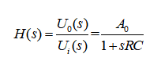

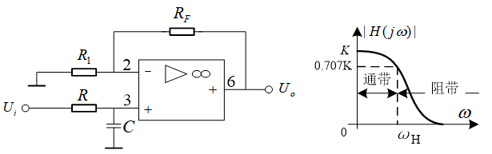

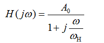

[图片不可用：源网页误引用作者电脑本地临时文件，无法下载]

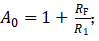

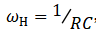

[图片不可用：源网页误引用作者电脑本地临时文件，无法下载]

[图片不可用：源网页误引用作者电脑本地临时文件，无法下载]

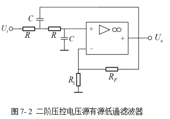

[图片不可用：源网页误引用作者电脑本地临时文件，无法下载]

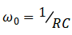

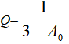

[图片不可用：源网页误引用作者电脑本地临时文件，无法下载]

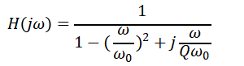

[图片不可用：源网页误引用作者电脑本地临时文件，无法下载]

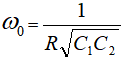

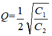

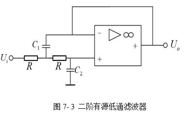

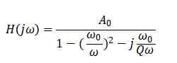

[图片不可用：源网页误引用作者电脑本地临时文件，无法下载]

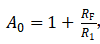

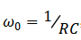

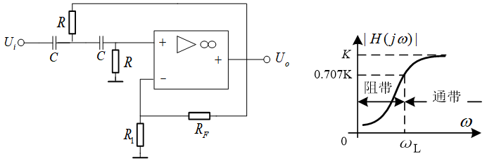

## 实验报告

### 第1题（10分）

请上传实操数据记录页（记录页上应写有个人姓名及学号、并附有教师盖章）。

### 第2题（10分）

绘制一阶有源低通滤波器的幅频特性曲线（可用对数坐标）（采用坐标纸或者网格纸，注意绘图规范，不要直接使用示波器照片，可以为手绘或者电脑作图），并与理论结果对比，分析是否有差异？

### 第3题（20分）

绘制R3=10kΩ，R4=20kΩ和R3=10kΩ，R4=10kΩ两种情况下的二阶有源低通滤波器的幅频特性曲线（可用对数坐标）（采用坐标纸或者网格纸，注意绘图规范，不要直接使用示波器照片，可以为手绘或者电脑作图）并与理论结果对比，分析是否有差异？

### 第4题（10分）

绘制二阶有源高通滤波器的幅频特性曲线（可用对数坐标）（采用坐标纸或者网格纸，注意绘图规范，不要直接使用示波器照片，可以为手绘或者电脑作图）并与理论结果对比，分析是否有差异？

### 第5题（10分）

在二阶有源低通滤波器实验过程中，结合实验数据，分析品质因数和什么因素有关？是否与理论一致。

### 第6题（10分）

二阶有源低通滤波器和一阶有源低通滤波器幅频特性的不同点是什么？

### 第7题（10分）

分析有源滤波器和无源滤波器的差异。

### 第8题（10分）

低通有源滤波电路和高通有源电路在结构上怎么区分？

### 第9题（10分）

有源滤波器的阶数和什么有关系？阶数和运放个数有什么关系？请简要分析？
