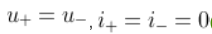
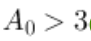

# 实验六、七、八预习题答案库

**题干内容据用户说明保持不变，但每次开始答题时，题目顺序和每题选项顺序都会变化。不得按题号、A/B/C/D或历史选项下标答题。必须先匹配题干，再按当前选项的文字或公式语义选择。**

本次三份试卷均为100分，并已确认覆盖课程成绩；服务端资源记录均为score=100、process=100、is_pass=1。仅验证本次账号/课程版本，不能据此保证其他版本相同。每实验10题；以下编号仅供本文件阅读，不是网页题号。

## 实验6

### 1. 理想运算放大器的开环放大倍数$A_{uo}$为？

- 答案：无穷大
- 依据：理想运放的开环增益趋于无穷大。

### 2. 理想运算放大器的输入电阻为？输出电阻为？

- 答案：无穷大，0
- 依据：理想输入电阻无穷大、输出电阻为零。

### 3. 集成运算放大器能处理什么类型的信号？

- 答案：交流信号和直流信号
- 依据：运放为直接耦合，可处理直流与交流。

### 4. 集成运放工作在线性放大区，由理想工作条件得出两个重要规律是？

- 答案：u+ = u−；i+ = i− = 0（虚短、虚断）
- 依据：线性负反馈下两输入端等电位且输入电流为零，并非两端电压都为零。
- 正确选项公式图：

### 5. 若要将幅度为$ \pm U_m$的矩形波转变为三角波，则应选用？

- 答案：积分运算电路
- 依据：恒定电压积分得到线性斜坡，矩形波积分为三角波。

### 6. 函数信号发生器需要交流量叠加直流输出时，需调节？

- 答案：偏移
- 依据：信号发生器的直流偏移设置叠加直流分量。

### 7. 分析集成运放的非线性应用电路时，不能使用的特性是？

- 答案：虚短
- 依据：非线性应用不保证两输入端电位相等。

### 8. 单限电压比较器有（ ）个门限电压，滞回电压比较器有（ ）个门限电压。

- 答案：1，2
- 依据：单限比较器一个阈值，滞回比较器两个阈值。

### 9. 当集成运放芯片的电源为正负对称电源供电时，不可把正、负电源极性接反或将输出端短路，否则会烧坏芯片。

- 答案：正确
- 依据：电源极性接反和输出短路可能损坏运放，须避免。

### 10. 在由运放组成的电路中，运放工作在非线性状态的电路是？

- 答案：电压比较器
- 依据：比较器使用运放的饱和非线性状态。

## 实验7

### 1. 有源滤波器的阶数越（ ），滤波器的滤波性能越 （ ）。

- 答案：高，好
- 依据：阶数增加使阻带衰减更陡，逼近理想特性。

### 2. 根据实验指导书的实验原理部分，二阶有源低通滤波器和二阶压控电压源有源低通滤波器特性描述正确的有哪些？

- 答案：二阶有源低通滤波器通带增益为1；二阶压控电压源低通Q=1/(3-A0)；二阶低通Q=(1/2)√(C1/C2)；二阶压控电压源低通A0=1+Rf/R1
- 依据：指导书7.4给出这四个表达式，全部成立。
- 本次四个选项均正确；重做时逐个核对选项内容，不能无条件执行“全选”。

### 3. 二阶压控电压源有源低通滤波器产生自激振荡的条件是什么？

- 答案：A0>3
- 依据：按指导书7.4，A0>3时极点进入右半平面，自激振荡。
- 正确选项公式图：

### 4. 有源滤波器与无源滤波器相比，在电路性能指标方面，其主要优势是什么？

- 答案：可以提供电压增益
- 依据：有源器件可在滤波同时提供增益。

### 5. 有源滤波器的带宽指的是什么？

- 答案：滤波器允许通过的最高频率与最低频率之差
- 依据：带宽为通带上下边界频率之差。

### 6. 有源带通滤波器的主要特点是什么？

- 答案：允许某一频段内的信号通过，其他频段信号被阻断
- 依据：带通通过中间频段并抑制两侧频段。

### 7. 在设计有源滤波器时，下列哪个参数通常不被考虑？

- 答案：滤波器的绝缘电阻
- 依据：该题列出的常用设计指标为截止频率、增益和功耗。

### 8. 在有源高通滤波器中，若要提高截止频率，以下哪种措施是有效的？

- 答案：减小电容值
- 依据：fc与RC乘积成反比，减小C提高截止频率。

### 9. 以下哪种方法不是用于改善有源滤波器性能的有效手段？

- 答案：减小滤波器的电源电压
- 依据：减小电源电压不是普遍改善性能的方法，可能减小动态范围。

### 10. 有源滤波器的主要分类有（ ）。

- 答案：低通滤波器；高通滤波器；带通滤波器；带阻滤波器
- 依据：按通带位置分为低通、高通、带通、带阻四类。
- 本次四个选项均正确；重做时逐个核对选项内容，不能无条件执行“全选”。

## 实验8

### 1. 三角波发生器电路中的R1和周期的关系？

- 答案：正相关
- 依据：T=4R4R1C/R2，其他量不变时T与R1正比。

### 2. 对三角波发生器的电路结构叙述正确的是？

- 答案：由同向输入的滞回比较器和积分电路组成
- 依据：指导书8.4图8-2采用同相输入滞回比较器和反相积分器。

### 3. 集成运算放大器是一种高增益的放大器，只要加入适当的反馈网络，利用（ ）原理，满足振荡的条件，就可以构成正弦波、方波、三角波和锯齿波等各种振荡电路

- 答案：正反馈
- 依据：振荡器借助正反馈满足起振条件。

### 4. 方波发生器电路里，为使输出电压限制在±UZ,应使用（） 器件。

- 答案：双向稳压管
- 依据：指导书使用双向稳压管DZ实现双极性限幅。

### 5. 三角波发生器电路的振荡周期为

- 答案：T=4R4R1C/R2
- 依据：阈值幅度为(R1/R2)UZ，积分斜率为UZ/(R4C)，周期为4R4R1C/R2。

### 6. 集成运放的输出端一般都接KΩ级别的电阻，主要起到防止电路电流过大，烧坏电路。

- 答案：正确
- 依据：kΩ级负载有助于限制输出电流，避免过载。

### 7. 负反馈放大电路不可能产生自激振荡。

- 答案：错误
- 依据：负反馈电路高频附加相移可使环路满足自激条件。

### 8. 三角波和方波通过改变充放电时间常数改变占空比

- 答案：正确
- 依据：分别调节充放电时间常数可改变上升下降时间比例及占空比；同时等比例改变二者不会改变占空比。

### 9. 示波器中的measure测量的幅值和理论教材中提到的幅值大小一样

- 答案：错误
- 依据：示波器Amplitude常表示高低电平之差，而教材幅值通常指相对中心的峰值，不能直接等同。

### 10. 在电路工作中，如果发现波形不对，或者异常声音或者异常发热，需要马上断电，检测电路。

- 答案：正确
- 依据：指导书8.5/8.6要求异常波形、声音或发热时立即断电检查。

